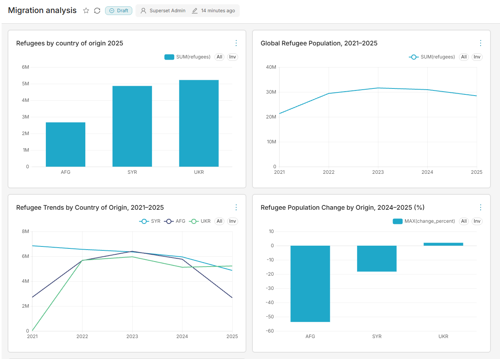

# Вынужденная миграция: 2021–2025

Учебный аналитический проект для портфолио GitHub на основе официального
API UNHCR Refugee Data Finder.

Цель — на практике освоить получение данных из API, обработку Python,
PostgreSQL, SQL-анализ и запуск компонентов через Docker Compose.

Текущая версия исследует показатель `refugees`:
беженцы под мандатом UNHCR, включая людей в ситуации,
подобной положению беженцев. Это не общее число всех
вынужденно перемещённых людей.

## Что реализовано

- Получение небольших выборок за 2021–2025 годы.
- Сохранение исходных ответов API без изменений.
- Запись адресов запросов, времени загрузки и контрольных сумм.
- Обработка данных Python и экспорт CSV.
- PostgreSQL 17 в Docker Compose.
- Загрузка с обновлением существующих записей без дубликатов.
- Проверки наличия ожидаемых годов и стран.
- SQL-анализ численности, годовых изменений и долей.
- Запуск пайплайна одной командой.
- Отдельный журнал каждого запуска и остановка при ошибке.

Расписание и дашборд пока не реализованы.

## Данные

| Выборка | Строк | Таблица PostgreSQL |
|---|---:|---|
| Мировые итоги за пять лет | 5 | refugee_world |
| Украина, Сирия и Афганистан по всем странам убежища | 15 | refugee_origins |
| Украина → Германия за пять лет | 5 | refugee_trend |

Эти выборки пересекаются: их нельзя складывать между собой.

## Технологии

- Python 3.11+ — стандартная библиотека, без дополнительных пакетов.
- PostgreSQL 17.
- Docker Desktop и Docker Compose.
- SQL и Git.
- Windows CMD — запуск через BAT-файл.

Python работает на Windows, PostgreSQL — в контейнере.
Весь пайплайн пока не контейнеризирован.

## Первый запуск на Windows

Нужны Python, Docker Desktop с работающим движком Linux-контейнеров
и доступ к API UNHCR. Для первой загрузки образа нужен доступ к Docker Hub.

Откройте CMD в папке проекта.

1. Создайте локальный файл настроек:

```bat
copy .env.example .env
notepad .env
```

Укажите в `.env` свой пароль:

```text
POSTGRES_PASSWORD=your_local_password
```

Файл `.env` исключён из Git. `.env.example` содержит только образец.

2. Запустите PostgreSQL:

```bat
docker compose up -d --wait
```

3. Запустите пайплайн:

```bat
run_pipeline.bat
```

При успехе появится `SUCCESS`, а в папке `logs` — журнал запуска.

Пароль из `.env` применяется при первоначальном создании базы.
Изменение `.env` само по себе не меняет пароль уже существующей базы.

## Повторный запуск

Запустите Docker Desktop, откройте CMD в папке проекта и выполните:

```bat
docker compose up -d --wait
run_pipeline.bat
```

Пайплайн повторно обращается к API. Одинаковые исходные ответы используют
тот же файл, изменённые сохраняются отдельными снимками.
Обработка читает файлы, указанные последней успешной загрузкой в `checks.json`.

CSV перезаписываются. В PostgreSQL применяется
`INSERT ... ON CONFLICT DO UPDATE`: существующие ключи обновляются,
новые добавляются.

## Как работает пайплайн

1. `check_api.py` получает и проверяет выборки API.
2. Скрипты `analyze*.py` читают JSON и создают CSV.
3. `schema.sql` создаёт отсутствующие таблицы.
4. Скрипты `load*.sql` загружают данные через временные таблицы.
5. `checks.sql` проверяет наличие ожидаемых годов и стран.
6. `analysis.sql` выполняет аналитические запросы.

Каждая SQL-загрузка выполняется в отдельной транзакции.
Весь пайплайн не является одной транзакцией:
если поздний этап завершится ошибкой, ранее сохранённые изменения останутся.

## Файлы проекта

| Файл или папка | Назначение |
|---|---|
| check_api.py | Получение и первичная проверка данных |
| analyze.py | Анализ пары Украина → Германия |
| analyze_origins.py | Анализ трёх стран происхождения |
| analyze_world.py | Обработка мировых итогов |
| compose.yaml | Настройки PostgreSQL в Docker |
| schema.sql | Создание таблиц |
| load.sql | Загрузка пары Украина → Германия |
| load_origins.sql | Загрузка итогов по странам происхождения |
| load_world.sql | Загрузка мировых итогов |
| checks.sql | Проверки покрытия годов и стран |
| analysis.sql | Аналитические SQL-запросы |
| run_pipeline.bat | Последовательный запуск и журналирование |
| .env.example | Образец локальных настроек |
| data/raw/ | Исходные JSON; исключены из Git |
| data/processed/ | Полученные CSV; исключены из Git |
| checks.json | Метаданные последней успешной загрузки; исключены из Git |
| logs/ | Журналы запусков; исключены из Git |

Данные PostgreSQL хранятся в именованном Docker-томе.
Папка обработанных CSV подключена к контейнеру как `/imports`
только для чтения.

## Работа с базой

Выполнить сохранённый анализ:

```bat
docker compose exec -T db psql -U analyst -d unhcr -v ON_ERROR_STOP=1 < analysis.sql
```

Открыть интерактивную консоль:

```bat
docker compose exec db psql -U analyst -d unhcr
```

Выйти из неё:

```text
\q
```

Остановить базу с сохранением данных:

```bat
docker compose stop db
```

Подключение с компьютера:
`127.0.0.1:5433`, база `unhcr`, пользователь `analyst`,
пароль из `.env`.

## Первые результаты

По выборке, использованной при разработке:

- Численность беженцев из Украины в Германии снизилась
  с 1 205 729 на конец 2024 года до 1 173 192 на конец 2025 года:
  на 32 537 человек, или 2,70%.
- Совокупная численность для Украины, Сирии и Афганистана
  на конец 2025 года — 12 761 455 человек.
- Их доля в мировом показателе `refugees` — 44,84%.
- В 2022 году эта доля составляла 60,84%.

Это описательные результаты, а не объяснение причин изменений.
При пересмотре данных источником результаты могут измениться.

## Поля и методология

`year` — отчётный год.
`coo` — страна происхождения, `coa` — страна убежища/проживания.
Поля с суффиксом `_iso` содержат ISO3-коды.
Коды UNHCR могут отличаться: например, Германия — `GFR` в UNHCR
и `DEU` в ISO3.

В ответе API также встречаются:

| Поле | Содержание |
|---|---|
| asylum_seekers | Люди, ожидающие решения по убежищу |
| idps | Внутренне перемещённые лица в охвате UNHCR |
| oip | Другие нуждающиеся в международной защите |
| stateless | Люди в рамках мандата UNHCR по безгражданству |
| ooc | Другие лица, представляющие интерес для UNHCR |
| hst | Принимающие сообщества, которым помогает UNHCR |
| returned_refugees | Беженцы, вернувшиеся за год |
| returned_idps | ВПЛ, вернувшиеся за год |

Эти дополнительные показатели сохраняются в исходном JSON,
но пока не загружаются в аналитические таблицы.

Основные ограничения:

1. Численность на конец года не равна новым перемещениям за год.
2. Годовые остатки нельзя складывать для подсчёта уникальных людей.
3. Возвраты за год нельзя суммировать с остатками на дату.
4. Изменение численности не позволяет само по себе определить причины:
   прибытия, возвращения, изменения статуса или пересмотр учёта.
5. `refugees` не включает отдельную статистику беженцев под мандатом UNRWA.
6. В числовых полях встречаются числа, строки `"0"` и `"-"`.
   `"-"` не заменяется автоматически нулём; требуется проверка сносок.
7. В географических полях наших агрегированных выборок `"-"`
   означает объединение соответствующего измерения.
8. Категория `oip` введена в 2022 году; сопоставимость с 2021 годом
   требует отдельной методологической проверки.
9. Исторические данные UNHCR могут пересматриваться.

## Проверки и текущие ограничения

Проверены повторная загрузка без дубликатов, совпадение годовых
изменений Python и SQL, остановка при недоступной базе
и успешный запуск после её восстановления.

Загрузчик проверяет ожидаемые размеры выборок, годы, ключи и фильтры.
`checks.sql` проверяет наличие пяти мировых итогов и 15 сочетаний
год–страна в таблице `refugee_origins`.

Это проверки структуры и ожидаемого покрытия выборки.
Они не доказывают полноту статистики по всем странам и категориям.

Текущий загрузчик принимает только одностраничные ответы.
Автоматические повторы запросов при сетевых ошибках пока отсутствуют.

Upsert не удаляет записи, исчезнувшие из источника.
`CREATE TABLE IF NOT EXISTS` не обновляет структуру существующих таблиц.

## Следующие этапы

- Проверить сноски UNHCR и причины крупных изменений.
- Расширить выборку по странам происхождения и убежища.
- Добавить пагинацию, обработку пропусков и дополнительные проверки.
- Реализовать отслеживание изменений и запуск по расписанию.
- Выбрать инструмент визуализации и создать дашборд.
- Подготовить итоговые выводы с методологическими оговорками.

## Источники

- [Документация API](https://api.unhcr.org/docs/refugee-statistics.html)
- [Объяснение API](https://www.unhcr.org/refugee-statistics/insights/explainers/forcibly-displaced-api.html)
- [Методология](https://www.unhcr.org/refugee-statistics/methodology)
- [Определения](https://www.unhcr.org/refugee-statistics/methodology/definition)
- [Структура данных](https://www.unhcr.org/refugee-statistics/methodology/data-content)

## Dashboard

The Apache Superset dashboard shows global refugee population trends,
trends for Afghanistan, Syria and Ukraine, and changes between 2024 and 2025.



Dashboard export: [migration_analysis.zip](dashboard/migration_analysis.zip).